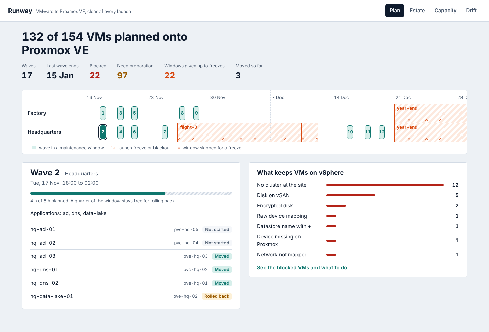

# hybrid-platform-runway

**Leave VMware for Proxmox VE without touching a launch campaign.** runway reads a vSphere estate,
decides for every VM whether it can move (and why not, with a source), plans the moves in waves
inside maintenance windows that keep clear of launch freezes, generates the Terraform and Ansible for
each VM, cuts waves over with rollback, and reports drift afterwards. Around it sits the platform
code a hybrid IT operation runs on: Terraform for AWS and Proxmox, Bicep for Azure, Ansible for
RHEL and Debian, Argo CD for OpenShift and Kubernetes, and a GitLab pipeline. One launch calendar
drives the planner, Argo CD and GitLab, so all three agree about when nothing may change.

The setting is a fictional launch-services company with three sites (headquarters, a factory with
test stands, a launch site) and 154 VMs, including the things that make a VMware exit hard: Windows
guests, UEFI and vTPM, snapshots, vSAN and encrypted disks, a raw device mapping, GPUs passed through
for ML training, an OT VLAN, and applications that depend on each other.



## What it does

| Step | How |
|---|---|
| **Inventory** | pyVmomi against vCenter: disks (datastore type, mode, backing, encryption), NICs (port groups, MACs), firmware, vTPM, snapshots, passthrough, and ownership notes (`runway.app=…`, `runway.depends=…`). Tested against VMware's vCenter simulator. |
| **Assess** | 16 rules in `config/rules.yaml`, each with its source (vSAN and encrypted disks the importer cannot read, Windows without VirtIO, snapshots, vTPM and BitLocker, unmapped networks, devices no node has…). Verdict per VM: moves by itself, needs preparation, or blocked with the action that unblocks it. |
| **Plan** | Applications move together, after what they depend on, inside maintenance windows that touch no freeze at their site, within each window's copy time with a quarter kept for rollback, onto nodes that leave every cluster able to lose its largest node, with anti-affinity spread. |
| **Generate** | Terraform (bpg/proxmox) per wave, validated against the provider in CI; MACs and VLANs kept; Windows boots from SATA until VirtIO is in; OVMF and EFI disk for UEFI guests; GPU mapping for passthrough. Ansible host_vars per VM. |
| **Prepare guests** | Ansible pins each interface's current name to its MAC (systemd .link), adds VirtIO to the initramfs, installs the guest agent before the move and removes VMware Tools after it. Molecule on Rocky 9 and Debian 12. |
| **Cut over** | Stop the source, create the Proxmox VM importing its disks from the ESXi storage, start it, verify by guest agent (its own MACs with an IPv4). Any failure rolls back: Proxmox copy destroyed first, then the source started. Every step journalled; an executor killed mid-import resumes safely. |
| **Drift** | Live Proxmox configuration against the generated code, per VM and field. |
| **Freezes** | `config/launch-calendar.yaml` → planner, Argo CD deny sync windows (CI fails if the committed project misses one), GitLab deploy freeze periods and a freeze gate per site with an audited emergency override. |

## Measured

From CI on the latest commit, where all nine jobs pass.

| What | Result |
|---|---|
| Blind held-out set `cases-1` (written from `heldout/WRITING_CASES.md` by someone who had not seen the code; first run pinned) | 42 VMs: verdict and every rule right on all 42, 0 blocked VMs let through. 12 wave plans: 88 of 88 hand-computed checks right, 0 violations of the planner's invariants |
| Cutover drill: 81 VMs against a Proxmox with 10% failed imports, 5% silent guests, 2% API errors, and the executor killed mid-import 9 times | 0 VMs running on both sides, 0 outages nobody was told about; the rest moved or rolled back cleanly |
| The fictional estate | 154 VMs: 132 planned in 17 waves, 22 blocked with reasons; 22 maintenance windows given up to the flight-3 freeze and the year-end blackout |
| Generated Terraform | 17 wave roots, 132 VMs, valid against bpg/proxmox |
| Argo CD on kind | syncs runway from the commit; during a launch freeze generated from the calendar it refuses: `cannot sync: blocked by sync window` |
| GitLab pipeline (gitlab-ci-local) | verify and plan jobs pass; the freeze gate blocks headquarters during flight-3, leaves the factory open, and accepts a named emergency approval |
| Tests | 35 Python tests plus 2 against vcsim, Molecule (converge, idempotence, verify) on two distributions, Terraform tests with mocked AWS and Proxmox, Bicep lint, kubeconform on the OpenShift overlay, 11 console unit tests, Playwright on desktop and phone against the real API |

What CI found and the fixes are in the commit history: Rocky 9 package names, directories minimal
images lack, kubectl's strict validation refusing a sync-window field Argo CD 2.14 does not know,
and the bpg provider's nested attributes that Terraform's JSON syntax cannot express (runway now
writes HCL).

## Run it

```bash
python -m venv .venv && .venv/bin/pip install -e ".[dev]"
.venv/bin/runway assess sim                      # verdict per VM of the fictional estate
.venv/bin/runway plan sim --start 2026-11-16     # waves, blocked, unplaced, skipped windows
.venv/bin/runway generate sim --start 2026-11-16 --out generated
.venv/bin/runway drill                           # the cutover drill, exits 1 on any invariant violation
.venv/bin/runway freeze check --site hq --at 2026-12-01T12:00:00+01:00
RUNWAY_PLAN_START=2026-11-16T00:00:00+01:00 .venv/bin/runway serve   # API on 8070
cd web && npm ci && npm run dev                  # console on 5173
```

Against a real estate: `runway inventory --vcenter https://vcenter/sdk --user … --out inventory.json`,
then use `inventory.json` instead of `sim`; set `RUNWAY_PVE_URL` and `RUNWAY_PVE_TOKEN` (the token
Terraform creates in `infra/terraform/proxmox.tf`) for real cutovers.

## Layout

`src/runway` (Python), `config` (rules, target, windows, launch calendar), `web` (console),
`infra/terraform` (AWS, Proxmox), `infra/bicep` (Azure hub), `infra/ansible` (roles, Molecule),
`platform/gitops` (Argo CD), `.gitlab-ci.yml` and `ci/gitlab`, `deploy` (images), `docs/adr`
(decisions), `docs/runbooks` (wave night, emergency change in a freeze), `heldout` (blind sets).

## Limits, stated plainly

- Never run against a real vCenter or Proxmox cluster. vSphere is VMware's simulator; Proxmox is a
  fake built from the documented `/api2/json` shapes, with failures injected on purpose.
- The import uses Proxmox's ESXi storage (`import-from`); copy times are planned from a configured
  throughput, not measured on a network.
- OpenShift is validated (kubeconform against a Route schema written from the API reference), not
  run; Kubernetes runs in kind.
- The AWS, Azure and Proxmox code passes validation and tests with mocked providers; it has not been
  applied to an account.
- The planner is conservative: one copy stream per window, a fixed rollback reserve, and an
  interrupted cutover is always rolled back, even when its import may have succeeded.
